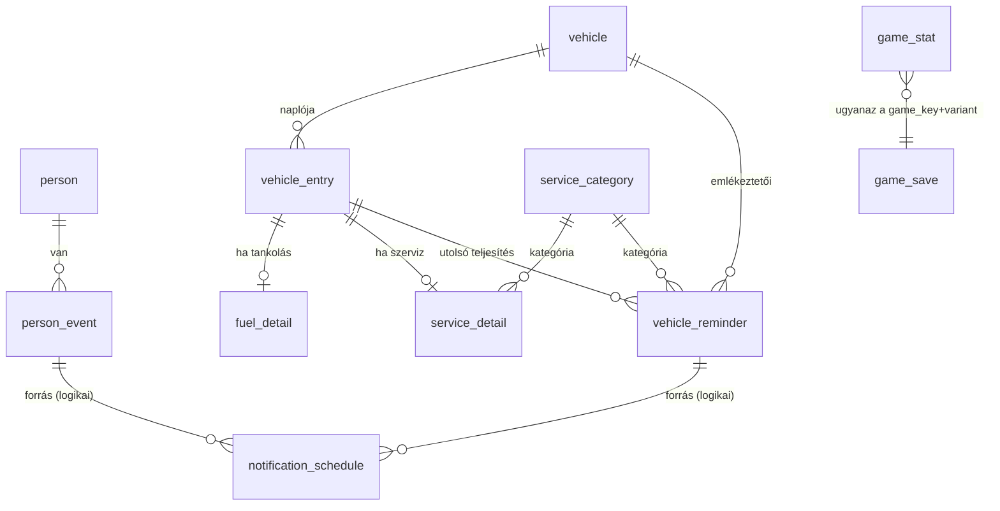

# Adatbázis- és projektterv – v1

Alapja: a `maui_android_app_latvanyterv_ai_brief.md` és az elkészült látványterv (8 képernyő).
Technológia: .NET MAUI, Android, **helyi SQLite**, bejelentkezés és felhő nélkül.

---

## 1. Alapelvek

| Téma | Döntés | Indok |
|---|---|---|
| Adatbázis | SQLite, egyetlen fájl az alkalmazás privát könyvtárában | Offline, nulla üzemeltetés, egy fájl = egyszerű mentés |
| Elsődleges kulcs | `INTEGER PRIMARY KEY AUTOINCREMENT` | Egyfelhasználós, helyi adat; GUID-ra csak szinkronizációnál lenne szükség |
| Időbélyegek (`created_at`, `updated_at`, `fire_at`) | `TEXT`, ISO 8601, **UTC** (`2026-10-27T09:00:00Z`) | Olvasható, rendezhető, időzóna-biztos |
| Naptári dátum (`entry_date`) | `TEXT`, `yyyy-MM-dd`, időzóna nélkül | A „tankolás napja” nem pillanat, nem szabad eltolódnia |
| Időpont napon belül (`remind_time`) | `TEXT`, `HH:mm` | Helyi idő, a készülék időzónája szerint értelmezve |
| Logikai érték | `INTEGER` 0/1 | SQLite-konvenció |
| Enum | `INTEGER`, a számértékek **rögzítettek** a kódban | A mentésben szereplő érték soha nem változhat |
| Pénz | `INTEGER`, egész forint | A forintnak nincs értelmezhető törtrésze; ha egyszer több pénznem kell, külön `currency` oszlop és fillér/cent egység |
| Mennyiség (liter) | `REAL` | 38,4 l – kerekítési hiba itt nem számít |
| Törlés | `ON DELETE CASCADE` a szülő–gyerek kapcsolatoknál | Személy törlése viszi az eseményeit; jármű törlése a naplóját |
| Származtatott adat | **Nem tároljuk**, számoljuk | Aktuális km-állás, fogyasztás, „hány nap múlva”, havi költség |

**Ami szándékosan nincs tárolva:** a következő előfordulás („okt. 29., 2 nap múlva”) és az aktuális kilométeróra-állás. Az éves ismétlődő esemény következő dátumát a `month`/`day` mezőkből, az aktuális km-t a `MAX(odometer_km)`-ből számoljuk. Így nem kerülhet ellentmondásba az adat önmagával.

> **Fontos SQLite-tudnivaló:** a külső kulcsokat minden új kapcsolatnál be kell kapcsolni: `PRAGMA foreign_keys = ON;`. Enélkül a `CASCADE` nem fut le. A sémaverziót a `PRAGMA user_version` tárolja (lásd 5. fejezet).

---

## 2. Táblák áttekintése és kapcsolatok



| Modul | Tábla | Szerep |
|---|---|---|
| Események | `person` | Személy (név, megjegyzés) |
| Események | `person_event` | Egy személy alkalmai: születésnap, névnap, egyéb |
| Jármű | `vehicle` | Jármű törzsadatai |
| Jármű | `vehicle_entry` | Napló: közös fejléc (dátum, km, költség) |
| Jármű | `fuel_detail` | Csak tankolásnál: liter, teli tank |
| Jármű | `service_detail` | Csak szervizhez: kategória, leírás |
| Jármű | `service_category` | Olajcsere, Fékek, Gumi, Műszaki vizsga, Egyéb |
| Jármű | `vehicle_reminder` | Karbantartási emlékeztető (km és/vagy dátum alapú) |
| Közös | `notification_schedule` | Beütemezett Android-értesítések nyilvántartása |
| Játékok | `game_stat` | Legjobb eredmény, játszott játékok játékonként |
| Játékok | `game_save` | Félbehagyott játék állapota |
| Közös | `app_setting` | Kulcs–érték beállítások |

### Miért „fejléc + részletező” a járműnapló?

A látványtervben a Napló egy időrendi lista, amely vegyesen mutat kilométeróra-rögzítést, tankolást és szervizt. Egyetlen `vehicle_entry` tábla ezt egyszerű lekérdezéssé teszi (`ORDER BY entry_date DESC`), a típusspecifikus mezők (liter, kategória) viszont nem szennyezik a közös táblát `NULL` oszlopokkal. Alternatíva: három külön tábla – az időrendi lista ilyenkor `UNION`, a km-állás keresése is háromfelé megy. A választott megoldás ennél egyszerűbb.

---

## 3. Táblák részletesen

Jelölés: **PK** elsődleges kulcs · **FK** külső kulcs · **NN** `NOT NULL` · **UQ** egyedi · `NULL` elhagyható.

### 3.1 `person`

| Oszlop | Típus | Megkötés | Megjegyzés |
|---|---|---|---|
| `id` | INTEGER | PK, autoincrement | |
| `name` | TEXT | NN, `COLLATE NOCASE` | Megjelenített név („Nagyi”, „Anna”) |
| `note` | TEXT | NULL | Szabad megjegyzés |
| `created_at` | TEXT | NN | UTC |
| `updated_at` | TEXT | NN | UTC |

Index: `(name)`.

### 3.2 `person_event`

Egy személyhez több alkalom tartozhat (a brief szerint).

| Oszlop | Típus | Megkötés | Megjegyzés |
|---|---|---|---|
| `id` | INTEGER | PK | |
| `person_id` | INTEGER | NN, FK → `person.id`, **CASCADE** | |
| `type` | INTEGER | NN | 1 = születésnap, 2 = névnap, 3 = egyéb |
| `custom_title` | TEXT | NULL | Csak `type = 3`-nál („Házassági évforduló”) |
| `month` | INTEGER | NN, `CHECK (1..12)` | |
| `day` | INTEGER | NN, `CHECK (1..31)` | |
| `year` | INTEGER | NULL | **Opcionális** (brief): ha ismert, ebből számolható a kor |
| `reminder_enabled` | INTEGER | NN, default 1 | |
| `remind_days_before` | INTEGER | NULL | `NULL` = globális alapérték (`app_setting`) |
| `remind_time` | TEXT | NULL | `HH:mm`; `NULL` = globális alapérték |
| `created_at`, `updated_at` | TEXT | NN | |

Indexek: `(person_id)`, `(month, day)` (a „közelgő” lista rendezéséhez).

Megjegyzések:
- **Nincs egyedi korlát** `(person_id, type)`-ra: valakinek lehet két névnapja (két keresztnév).
- **Február 29.**: a megjelenítő logika döntse el, hogy nem szökőévben február 28-án vagy március 1-jén jelez. Ez *szabály*, nem adat; javaslat: február 28.
- Egy emlékeztető fér a v1-be (`remind_days_before`). Ha később „1 hét *és* 1 nap előtt” kell, külön `event_reminder` tábla lesz.

### 3.3 `vehicle`

A látványterv egy járművet mutat („Saját autó”), de a séma már több járműre is jó, az UI-t ez nem terheli.

| Oszlop | Típus | Megkötés | Megjegyzés |
|---|---|---|---|
| `id` | INTEGER | PK | |
| `name` | TEXT | NN | „Saját autó” |
| `make` | TEXT | NULL | Gyártó |
| `model` | TEXT | NULL | Típus |
| `model_year` | INTEGER | NULL | |
| `license_plate` | TEXT | NULL | |
| `fuel_type` | INTEGER | NULL | 1 benzin, 2 dízel, 3 hibrid, 4 elektromos, 5 LPG |
| `initial_odometer_km` | INTEGER | NN, default 0 | Alsó korlát a km-validációhoz |
| `is_archived` | INTEGER | NN, default 0 | Eladott autó elrejtése törlés nélkül |
| `created_at`, `updated_at` | TEXT | NN | |

### 3.4 `vehicle_entry` (a napló)

| Oszlop | Típus | Megkötés | Megjegyzés |
|---|---|---|---|
| `id` | INTEGER | PK | |
| `vehicle_id` | INTEGER | NN, FK → `vehicle.id`, **CASCADE** | |
| `entry_type` | INTEGER | NN | 1 = kilométeróra, 2 = tankolás, 3 = szerviz/javítás |
| `entry_date` | TEXT | NN | `yyyy-MM-dd` |
| `odometer_km` | INTEGER | NN, `CHECK (>= 0)` | Mind a három típusnál megvan (a látványterv mindhárom űrlapján szerepel) |
| `total_cost` | INTEGER | NULL | Ft; kilométeróra-bejegyzésnél `NULL` |
| `note` | TEXT | NULL | Megjegyzés |
| `created_at`, `updated_at` | TEXT | NN | |

Indexek: `(vehicle_id, entry_date DESC, id DESC)` a naplóhoz; `(vehicle_id, odometer_km)` az aktuális állás és az intervallumok kereséséhez.

Validáció (alkalmazásszinten, nem adatbázis-megszorításként): az új km-állás kisebb az előzőnél → figyelmeztetés, ne tiltás (elírás, óracsere előfordul).

### 3.5 `fuel_detail`

| Oszlop | Típus | Megkötés | Megjegyzés |
|---|---|---|---|
| `entry_id` | INTEGER | **PK**, FK → `vehicle_entry.id`, CASCADE | 1:1 kapcsolat |
| `liters` | REAL | NN, `CHECK (> 0)` | |
| `is_full_tank` | INTEGER | NN, default 1 | Fogyasztásszámításhoz kell: csak teli tankolások között pontos |

Ft/liter = `total_cost / liters`; fogyasztás (l/100 km) két teli tankolás között számolva. Egyik sem tárolt oszlop.

### 3.6 `service_detail`

| Oszlop | Típus | Megkötés | Megjegyzés |
|---|---|---|---|
| `entry_id` | INTEGER | **PK**, FK → `vehicle_entry.id`, CASCADE | 1:1 |
| `category_id` | INTEGER | NN, FK → `service_category.id`, **RESTRICT** | |
| `description` | TEXT | NULL | „Első fékbetét és tárcsa” |
| `workshop` | TEXT | NULL | Műhely neve (később jól jön) |

### 3.7 `service_category`

| Oszlop | Típus | Megkötés | Megjegyzés |
|---|---|---|---|
| `id` | INTEGER | PK | |
| `name` | TEXT | NN, UQ | |
| `is_system` | INTEGER | NN, default 0 | Előre feltöltött; ne lehessen törölni |
| `sort_order` | INTEGER | NN | |

Kezdő adatok (a látványterv chipjei): Olajcsere, Fékek, Gumi, Műszaki vizsga, Egyéb.

### 3.8 `vehicle_reminder`

Ez adja a kezdőlap „Olajcsere 2 000 km múlva” sorát.

| Oszlop | Típus | Megkötés | Megjegyzés |
|---|---|---|---|
| `id` | INTEGER | PK | |
| `vehicle_id` | INTEGER | NN, FK → `vehicle.id`, CASCADE | |
| `title` | TEXT | NN | „Olajcsere” |
| `category_id` | INTEGER | NULL, FK → `service_category.id`, SET NULL | Teljesítéskor ebből köthető a szervizhez |
| `interval_km` | INTEGER | NULL | Pl. 15 000 |
| `interval_months` | INTEGER | NULL | Pl. 12 |
| `last_done_km` | INTEGER | NULL | |
| `last_done_date` | TEXT | NULL | `yyyy-MM-dd` |
| `last_entry_id` | INTEGER | NULL, FK → `vehicle_entry.id`, SET NULL | Melyik szerviz teljesítette utoljára |
| `due_km` | INTEGER | NULL | Gyorsítótár: `last_done_km + interval_km` |
| `due_date` | TEXT | NULL | Gyorsítótár; egyszeri emlékeztetőnél (műszaki) közvetlenül megadható |
| `notify_before_km` | INTEGER | NULL | Mikortól „közeleg” (a kezdőlapi sárga sáv) |
| `notify_before_days` | INTEGER | NULL | |
| `is_active` | INTEGER | NN, default 1 | |
| `created_at`, `updated_at` | TEXT | NN | |

Km-alapú értesítés nem időzíthető előre (nem tudjuk, mikor éri el az autó): ezt az alkalmazás **új km-rögzítéskor értékeli ki**, nem alarm. A dátum-alapú ágból lesz ütemezett értesítés.

### 3.9 `notification_schedule`

Az Android a készülék újraindításakor törli az alarmokat, az ismétlődő események pedig évente térnek vissza, ezért érdemes nyilvántartani, mit ütemeztünk be.

| Oszlop | Típus | Megkötés | Megjegyzés |
|---|---|---|---|
| `id` | INTEGER | PK | Egyúttal az Android értesítés-azonosító is lehet |
| `source_type` | INTEGER | NN | 1 = `person_event`, 2 = `vehicle_reminder` |
| `source_id` | INTEGER | NN | **Nem valódi FK** (két táblára mutat); a forrás törlésekor az alkalmazás takarít |
| `fire_at` | TEXT | NN | UTC |
| `title` | TEXT | NN | |
| `body` | TEXT | NULL | |
| `status` | INTEGER | NN | 0 függőben, 1 elsült, 2 törölve |

Index: `(status, fire_at)`, `(source_type, source_id)`.

Ütemezési stratégia: nem az összes jövőbeli évet, hanem egy **gördülő ablakot** (pl. következő 60 nap) ütemezzük; az alkalmazás indulásakor, újraindítás után (boot receiver) és beállításmódosításkor újratervezünk. Az `SCHEDULE_EXACT_ALARM` és Android 13+ esetén a `POST_NOTIFICATIONS` engedélyt a Beállítások képernyőn érdemes kezelni.

### 3.10 `game_stat`

| Oszlop | Típus | Megkötés | Megjegyzés |
|---|---|---|---|
| `game_key` | TEXT | PK (1/2) | `game2048`, `sudoku`, `minesweeper`, `battleship` |
| `variant` | TEXT | PK (2/2), NN, default `''` | Nehézség: `easy`, `hard`… (2048-nál üres) |
| `best_score` | INTEGER | NULL | Játéktól függően pont vagy idő (ms) |
| `games_played` | INTEGER | NN, default 0 | |
| `games_won` | INTEGER | NN, default 0 | |
| `total_play_seconds` | INTEGER | NN, default 0 | |
| `last_played_at` | TEXT | NULL | UTC |

A „legjobb” jelentése játékonként eltér (2048: több a jobb; aknakereső: kevesebb idő a jobb). Ezt a játék kódja tudja; az adatbázis csak a számot tárolja.

### 3.11 `game_save`

| Oszlop | Típus | Megkötés | Megjegyzés |
|---|---|---|---|
| `game_key` | TEXT | PK (1/2) | |
| `variant` | TEXT | PK (2/2), NN, default `''` | |
| `state_json` | TEXT | NN | A játék saját, verziózott állapota |
| `schema_version` | INTEGER | NN | A JSON formátum verziója – külön a DB sémától |
| `updated_at` | TEXT | NN | |

Játékonként egyetlen mentett állás. Rácsállapotot nem érdemes oszlopokra bontani.

### 3.12 `app_setting`

| Oszlop | Típus | Megkötés |
|---|---|---|
| `key` | TEXT | PK |
| `value` | TEXT | NN |
| `updated_at` | TEXT | NN |

Kezdő kulcsok:

| Kulcs | Alapérték | Képernyő |
|---|---|---|
| `notifications_enabled` | `true` | Beállítások |
| `default_remind_time` | `09:00` | Beállítások |
| `default_remind_days_before` | `1` | Személy szerkesztése („1 nappal előtte”) |
| `theme` | `light` | Beállítások (a sötét később) |
| `last_backup_at` | – | Beállítások |

Miért tábla és nem `Preferences`? Mert a **mentés tartalmazza**: visszaállítás után a beállítások is visszajönnek. A pusztán eszközfüggő dolgok (pl. engedélykérés megjelent-e) mehetnek `Preferences`-be.

---

## 4. Képernyő → adat megfeleltetés

| Képernyő | Olvas | Ír |
|---|---|---|
| Kezdőlap | `person_event` + `person` (3 legközelebbi), `vehicle` + `MAX(odometer_km)`, legközelebbi `vehicle_reminder`, `game_stat` | – |
| Események | `person_event` + `person`, szűrés `type` szerint | – |
| Személy szerkesztése | `person`, `person_event`, `app_setting` (alapértékek) | `person`, `person_event`, `notification_schedule` |
| Jármű áttekintő | `vehicle`, `vehicle_entry` (+ részletezők), havi `SUM(total_cost)` | – |
| Új bejegyzés | `service_category`, utolsó km | `vehicle_entry` + `fuel_detail` / `service_detail`, `vehicle_reminder` újraszámítás |
| Játékterem / 2048 | `game_stat`, `game_save` | `game_stat`, `game_save` |
| Beállítások | `app_setting` | `app_setting`, mentés/visszaállítás |

A látványtervben a **havi költség** és a fogyasztás mind származtatott érték: nincs rá oszlop.

---

## 5. Migráció, mentés, visszaállítás

**Migráció.** A séma verziója `PRAGMA user_version`. Az `Data/Migrations/` mappában számozott, egyirányú lépések (`M001_Initial`, `M002_…`), induláskor a hiányzókat sorban lefuttatjuk egy tranzakcióban. Soha nem módosítunk már kiadott migrációt, csak újat írunk.

**Mentés.** Javaslat: az adatbázisfájl konzisztens másolata (`VACUUM INTO 'backup.db'`) a rendszer fájlmentő párbeszédén át. Előnye: nulla szerializációs kód. A JSON-export hordozhatóbb, de minden táblához külön leképezés kell – ez v2 ötlet.

**Visszaállítás.** Sorrend: fájl kiválasztása → ellenőrzés (`PRAGMA integrity_check`, `user_version` ≤ az app verziója) → megerősítő párbeszéd (a látványtervben már megvan) → kapcsolat lezárása → fájlcsere → migráció futtatása → értesítések újraütemezése.

**ORM-választás.** A séma ORM-független. `sqlite-net-pcl` a legkönnyebb; vigyázat: a `DateTime` alapból tick-ként tárolódik – használj `storeDateTimeAsTicks: false`-t, a dátum-only mezők legyenek `string` + konverter. Az **EF Core SQLite** `DateOnly`-t, beépített migrációt és FK-kezelést ad, cserébe nehezebb. Hobbiprojektnél mindkettő rendben van; javaslat: `sqlite-net-pcl` és kézi migráció.

---

## 6. Projektstruktúra – javasolt módosításokkal

A beillesztett terv jó alap, a feature-alapú bontás helyes. Ezeket módosítanám:

| # | Észrevétel | Javaslat |
|---|---|---|
| 1 | `Reminders` a menüben **Események** | Átnevezés `Events`-re; az UI és a kód szóhasználata egyezzen |
| 2 | `Reminders/Calendar` nincs a látványtervben | Kihagyni; ha később naptárnézet kell, akkor visszakerül |
| 3 | Az értesítés három helyen szerepel (`Reminders/Notifications`, `Services/Notifications`, `Features/…`) | Egy hely: `Services/Notifications` (ütemező logika) + `Platforms/Android` (tényleges Android-kód) |
| 4 | `Services/Navigation` duplikálja a `Navigation/` mappát | Összevonni a `Navigation/` mappába |
| 5 | A `Platforms/` mappa hiányzik | Hozzáadni: Android `AlarmReceiver`, `BootReceiver`, jogosultságok |
| 6 | Az entitások feature-ön belüli `Models/`-ben vannak, az `AppDatabase` pedig központi → körkörös függés | `Data/Entities/` a perzisztens osztályoknak, a feature-ök `Models/`-e csak UI-modell/DTO |
| 7 | `Shared/Controls` és `Shared/Components` ugyanazt jelenti | Összevonni (`Controls`) |
| 8 | `Shared/Styles` és `Shared/Themes` | A MAUI-konvenció a `Resources/Styles`; ott tartani a `Colors.xaml`-t, `Styles.xaml`-t |
| 9 | A játék logikája és a nézete nincs szétválasztva | Minden játéknál `Engine/` (tiszta C#, UI-független) + `Views/`; az engine egységtesztelhető |
| 10 | Tesztprojekt hiányzik | `MyAssistant.Tests` (xUnit): dátumszámítás, fogyasztás, esedékesség, játékmotorok, migrációk |
| 11 | A névnapnaptár adatforrása nincs | `Resources/Raw/nevnapok.json` – a név megadásakor automatikusan javasolható a névnap |

Javasolt kezdő csomagok: `CommunityToolkit.Mvvm`, `CommunityToolkit.Maui`, `sqlite-net-pcl` (+ `SQLitePCLRaw.bundle_green`), egy helyi értesítési könyvtár (pl. `Plugin.LocalNotification`) vagy saját Android-implementáció.

```
Zsebtars/                          (a név a 7. fejezetben)
├── Zsebtars.sln
│
├── src/
│   └── Zsebtars/
│       ├── App.xaml / App.xaml.cs
│       ├── MauiProgram.cs                 ← DI-regisztráció, DB-inicializálás
│       │
│       ├── Core/
│       │   ├── Constants/                 ← EntryType, EventType enumok (rögzített számértékekkel)
│       │   ├── Extensions/
│       │   ├── Helpers/                   ← HungarianFormat (2026. október 27., 128 450 km, Ft)
│       │   └── Interfaces/
│       │
│       ├── Navigation/
│       │   ├── AppShell.xaml              ← alsó TabBar: Kezdőlap · Események · Jármű · Játékok
│       │   └── Routes.cs                  ← Beállítások, űrlapok: Shell-útvonalak
│       │
│       ├── Shared/
│       │   ├── Controls/                  ← Kártya, SegmentedControl, ToggleRow, ConfirmDialog
│       │   └── Converters/
│       │
│       ├── Features/
│       │   ├── Home/
│       │   │   ├── Views/ · ViewModels/ · Services/
│       │   ├── Events/                    ← korábban Reminders
│       │   │   ├── Views/                 ← EventListPage, PersonEditPage
│       │   │   ├── ViewModels/
│       │   │   ├── Models/                ← UI-modellek (pl. UpcomingEventItem)
│       │   │   └── Services/              ← EventService, NextOccurrenceCalculator, NameDayLookup
│       │   ├── Vehicle/
│       │   │   ├── Views/                 ← OverviewPage, EntryEditPage, LogPage
│       │   │   ├── ViewModels/
│       │   │   ├── Models/
│       │   │   └── Services/              ← VehicleService, ConsumptionCalculator,
│       │   │                                MaintenanceDueEvaluator, CostStatistics
│       │   ├── Arcade/
│       │   │   ├── Catalog/               ← ArcadePage, GameCard
│       │   │   ├── Shared/                ← IGame, GameStatService, GameSaveService
│       │   │   └── Games/
│       │   │       ├── Game2048/          ← Engine/ · Views/ · ViewModels/
│       │   │       ├── Sudoku/
│       │   │       ├── Minesweeper/
│       │   │       └── Battleship/
│       │   └── Settings/
│       │       ├── Views/ · ViewModels/
│       │
│       ├── Data/
│       │   ├── AppDatabase.cs             ← kapcsolat, PRAGMA foreign_keys = ON
│       │   ├── Entities/                  ← Person, PersonEvent, Vehicle, VehicleEntry, …
│       │   ├── Migrations/                ← M001_Initial.cs, …
│       │   ├── Seed/                      ← service_category kezdő adatok
│       │   └── Repositories/              ← PersonRepository, VehicleRepository, …
│       │
│       ├── Services/                      ← feature-ek közötti infrastruktúra
│       │   ├── Backup/                    ← BackupService (export / restore)
│       │   ├── Notifications/             ← NotificationScheduler (gördülő ablak)
│       │   └── Preferences/               ← SettingsService (app_setting)
│       │
│       ├── Platforms/
│       │   └── Android/                   ← AlarmReceiver, BootReceiver, AndroidManifest
│       │
│       └── Resources/
│           ├── AppIcon/ · Splash/ · Fonts/ · Images/
│           ├── Styles/                    ← Colors.xaml, Styles.xaml
│           └── Raw/                       ← nevnapok.json
│
├── tests/
│   └── Zsebtars.Tests/                    ← xUnit
│
└── docs/
    └── adatbazis_es_projektstruktura.md   ← ez a dokumentum
```

Réteghatárok (egyszerű szabály): `View → ViewModel → Feature Service → Repository → AppDatabase`. A Feature Service tartalmazza az üzleti szabályt (pl. következő előfordulás, esedékesség), a Repository csak lekérdez és ír. A `Services/` gyökérmappa kizárólag olyan dolgot tartalmaz, amit több feature használ.

---

## 7. Névötletek

A `MyAssistant` valóban inkább munkacím: általános, angol, a „My…” előtag pedig a MAUI/Visual Studio sablonok hangulatát idézi. Magyar felületű, személyes, helyi alkalmazáshoz jobban illik egy rövid, könnyen megjegyezhető név. A `Memofy` kimarad, ahogy kérted.

| Név | Jelentés / hangulat | Megjegyzés |
|---|---|---|
| **Zsebtárs** | „zsebben hordott társ” | Személyes, barátságos; pont az „asszisztens” érzet. **Ez a javaslatom.** Kódnévtérnek: `Zsebtars` |
| **Kéznél** | „kéznél van” | Rövid, szép szó, de ékezet nélkül (`Keznel`) kevésbé mutat jól |
| **Zsebnaptár** | zsebben hordott naptár | Kicsit a naptárra szűkít, a játék és jármű kilóg belőle |
| **Háztáj** | otthoni, személyes dolgaid | Meleg, magyar; kevésbé műszaki |
| **Nook** | meghitt kis sarok | Rövid, nemzetközi, jól mutat ikon alatt |
| **Trió** | három terület | Egyszerű, de ha egy negyedik modul jön, elavul |
| **Almanach** | régi évkönyv/naptár, névnapokkal | Stílusos, a névnapra utal; kicsit komolykodó |
| **Pocketly** | pocket + -ly | Angol, „startup” hangzású |

Ellenőrizd a végleges névnél, hogy a Google Play-ben és a csomagazonosítóban (pl. `hu.<neved>.zsebtars`) szabad-e. Ezt innen nem tudtam megnézni.

---

## 8. Nyitott kérdések

1. **Több jármű?** A séma kezeli; az UI egyet mutat. Döntsd el, kell-e járműváltó.
2. **Km-alapú értesítés**: elég az alkalmazásban kiértékelni (új km rögzítésekor), vagy kell háttér-ellenőrzés? Előbbi egyszerűbb.
3. **Mentés formátuma**: adatbázisfájl (javasolt v1) vagy JSON.
4. **Névnap automatikus kitöltése** a névből – kell a v1-be, vagy csak kézi dátum?
5. **Fogyasztás megjelenítése** (l/100 km): a látványtervben nincs, de az adat megvan hozzá.
6. **Játékok eredményei**: elég a legjobb érték (`game_stat`), vagy kell előzmény-lista is (`game_result` tábla)?
